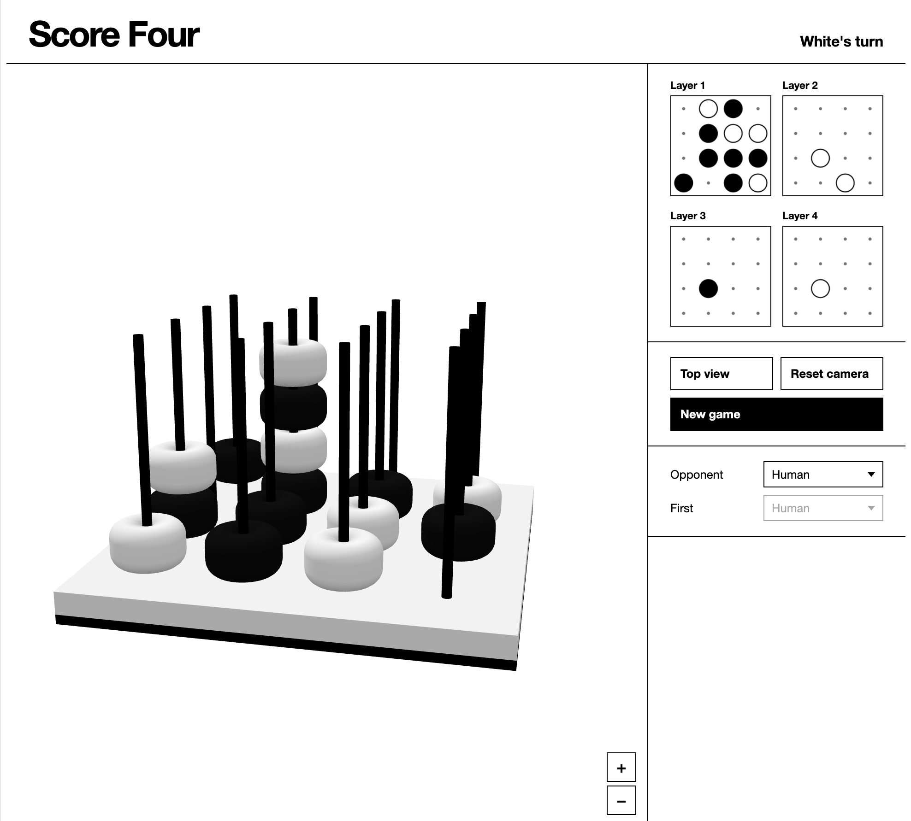

# Score Four

Connect four in 3D: drop beads on a 4×4 grid of pegs and get four in a row in any direction.



## Embed

```html
<script type="module" src="https://unpkg.com/score-four"></script>
<score-four opponent="cpu" style="height: 600px"></score-four>
```

Attributes: `opponent` (`2p` or `cpu`, default `2p`), `first` (`human` or `cpu`), `show-title` (`false` hides the heading).

### With a bundler

```bash
npm install github:arissafram/score-four
```

```js
import 'score-four';                      // registers <score-four>
import { mount } from 'score-four';       // or mount(el, { opponent: 'cpu' })
import { ScoreFour } from 'score-four';   // or the React component
import 'score-four/styles';               // CSS for mount() and <ScoreFour />
```

`mount(el, options)` returns `{ game, play(peg), newGame(), destroy() }`. `three` is a dependency; React is an optional peer dependency. The script-tag file `dist/score-four.js` bundles three.

## Develop

```bash
npm install
npm run dev      # index.html, the full-page game
npm test
npm run build    # dist/, then open demo.html
```
